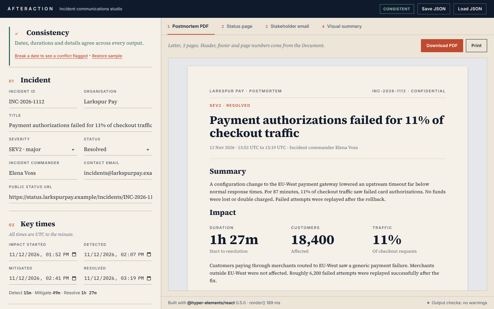
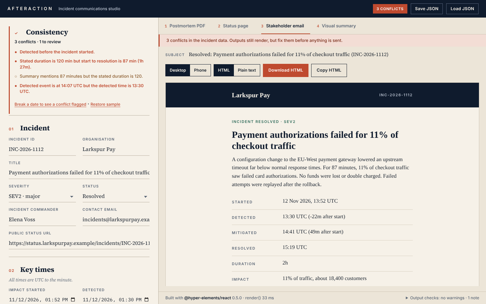
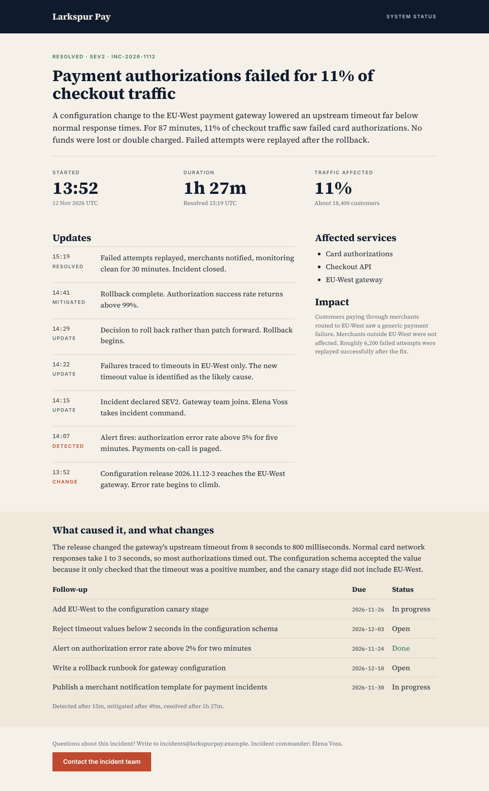
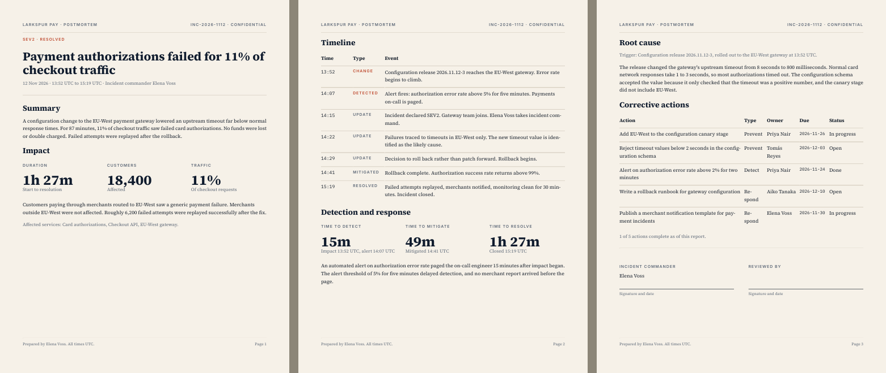
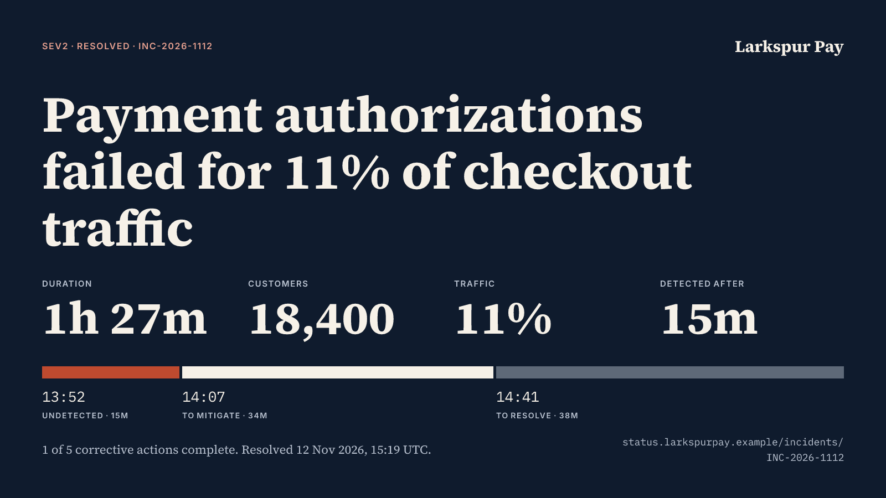

# AFTERACTION

**An incident communications studio built with [`@hyper-elements/react`](https://github.com/hyper-elements/hyper-elements).**
Enter an incident once. Get four coordinated outputs, all rendered by Hyper Elements from one data model:

| # | Output | Hyper Elements root | Made with |
|---|---|---|---|
| 1 | Postmortem PDF (3 pages, Letter) | `Document` | `render()` for the live preview, `renderPdf()` for the file |
| 2 | Public status page | `Page` | `render()` |
| 3 | Stakeholder email | `Email` | `render()` (HTML and plain text) |
| 4 | Visual incident summary (1600 x 900) | `Canvas` | `renderImage()` for the PNG |



## What it does

- **A real editor.** A preloaded sample incident with editable details, key times, impact, root cause, timeline events and corrective actions. Every change updates the previews live.
- **Four live previews** you can switch between. The page and email have desktop and phone widths, the email has an HTML and a plain text view.
- **A consistency check.** The data model is checked as you type. It flags conflicting dates, durations and details instead of silently printing them:
  - detected before the impact started, mitigated before detected, resolved before mitigated
  - a stated duration that disagrees with start-to-resolution
  - timeline "Detected / Mitigated / Resolved" events that disagree with the key times
  - a summary that quotes a different percentage or number of minutes than the impact section
  - SEV1 with tiny impact, SEV3 with huge impact, overdue actions, missing owners, bad email or URL
  
  Click "Break a date to see a conflict flagged" in the app to watch it work.



## The four outputs







## How Hyper Elements is used

This is not a mockup. Every output on screen and every file you download is produced by the library.

- **One theme for the whole brand.** `defineTheme()` in `src/theme.ts` sets the colors, body font, heading scale, button style and named styles (`label`, `mono`, `small`, `stat`). All four roots take the same `theme`, and designs read colors with `token("colors.accent")`.
- **Four roots, one data model.** `src/outputs.tsx` holds `PostmortemDocument` (`Document` with `Document.Page`, `PageHeader`, `PageFooter`, `PageNumber`), `StatusPage` (`Page` with `Section`), `StakeholderEmail` (`Email`) and `SummaryCanvas` (`Canvas`). Each takes the same `Incident` object.
- **Rendering in the browser.** `render()` runs client side (`src/render.ts`), so the editor needs no server for previews. The `diagnostics` it returns are shown under each preview, for example the email client notes.
- **Real PDF and PNG.** `renderPdf()` and `renderImage()` need Node libraries, so a small local endpoint in `vite.config.ts` calls them (`src/server/exporters.tsx`). Nothing leaves your machine.
- **Fitted headline text.** The Canvas headline uses `fit` so the image draws the largest size that fits in three lines.
- **Proportional timeline bar.** The Canvas draws impact, response and recovery as Row segments whose `flex` values are the real minutes.
- **The library's own validator helped build it.** It caught misplaced props and unsupported email styles while this was written.

## Run it

```bash
npm install
npm run dev        # open http://127.0.0.1:5173
```

```bash
npm run check      # consistency engine tests + typecheck
npm run export     # writes postmortem.pdf, status-page.html, stakeholder-email.html/.txt, incident-summary.png to out/
npm run export -- my-incident.json out --force
```

Use **Save JSON** in the app to get an incident file, then export it from the command line. The export exits with an error if the incident has conflicts, unless you pass `--force`.

## Notes and limits

- **No backend and no sign in.** State is saved in your browser's local storage. PDF and PNG downloads use the local dev server, so `npm run build` gives a static app where previews and HTML downloads work but PDF and PNG downloads need `npm run dev`.
- **Sample data only.** Larkspur Pay and everyone named in the sample are fictional.
- **Fonts** are Source Serif 4, Inter and IBM Plex Mono (SIL Open Font License). `npm install` copies them from the `@fontsource` packages into `public/fonts`, so the repository holds no binary font files.
- The consistency checks catch the common contradictions. They cannot know whether the facts are true.

MIT licensed.
